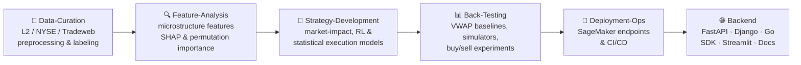

<div align="center">

# 🏛️ Blockhouse-GH

**Quantitative trading research and infrastructure monorepo:**
**data curation → feature analysis → strategy development → back-testing → deployment.**


</div>

---

## 🎯 What's inside

The research behind Blockhouse's **optimal trade execution** work: ML and reinforcement-learning models that split a large equity order into child orders while minimizing market impact. Around those models sit the services that serve them as reports, APIs, and dashboards.



## 🗺️ Repository map

| Area | Highlights |
|---|---|
| 🧹 **[Data-Curation](Data-Curation/)** | Level-2 order-book OHLCV preprocessing, NYSE preprocessing, Tradeweb dataset cleaning (symbol splitting, matching), EDA, labeling, a configurable Python pipeline |
| 🔍 **[Feature-Analysis](Feature-Analysis/)** | Liquidity and microstructure features: Kyle's λ, VPIN volatility, Roll and Corwin–Schultz spreads, high–low volatility, QADF, Fibonacci levels, tick, news and sentiment features, PCA. Feature importance via **SHAP** and **permutation importance** |
| 🧠 **[Strategy-Development](Strategy-Development/)** | Brokmann linear market-impact model, a myopic execution model (α/β/λ estimation), statistical model 4, several generations of RL execution models, smart order routing (SOR), and the `Main_Package` that powers the Blockhouse and Hoodwinked reports and the website |
| 📊 **[Back-Testing](Back-Testing/)** | `backtest_lib` (cross-validation, Monte Carlo, equities), adjusted and enhanced **VWAP** baselines, a dense-reward RL execution agent, a Gordon Ritter–style bet-sizing model, a Toke–Yoshida market simulator, buy/sell equity experiments, live-trading library, Streamlit backtest viewer |
| 🚀 **[Deployment-Ops](Deployment-Ops/)** | MLOps code and deployment scripts for the SageMaker real-time inference endpoints (Blockhouse Report, Hoodwinked Report & Charts, Blockhouse Calculator, website), CI/CD integration, instance checks |
| 🌐 **[Backend](Backend/)** | Django app (analytics, chatbot, firms), a clean-architecture **FastAPI** template, a **Go** transfer API (Redpanda/Kafka, MongoDB, S3), the Blockhouse **Python SDK**, a Streamlit firm explorer, and Docusaurus SDK docs |

## ⚙️ Continuous delivery

| Workflow | What it does |
|---|---|
| `python-tests.yml` | Python test suite |
| `FastAPI.yml`, `deploy-fast-api.yml` | Build the FastAPI app in Docker and deploy it to EC2 (staging / production / development) |
| `deploy-django.yml` | Deploy the Django app to EC2 |
| `deploy-go.yml` | Deploy the Go API to EC2 |
| `deploy-streamlit.yml` | Deploy the Streamlit dashboard to EC2 |
| `deploy_sagemaker.yaml` | Deploy strategy code to SageMaker |

## 🚀 Quick start

Most research lives in notebooks (236 of them) beside the Python modules they use. Each area has its own README with setup steps, for example:

```python
# Production inference, from Back-Testing/README.md
from blockhouse_ml.ml_prod import run_equities_buy_inference
trades = run_equities_buy_inference("AAPL", inventory=1000)
# -> [{'step': 1, 'timestamp': ..., 'order_type': 'Market', 'volume': 3457, 'limit_price': 224.88}, ...]
```

- Back-testing environment: `Back-Testing/environment.yml` (conda; TA-Lib from conda-forge)
- FastAPI service: [`Backend/FastAPI/README.md`](Backend/FastAPI/README.md)
- Go API (Go 1.20+, Redpanda, MongoDB, AWS CLI): [`Backend/Go/transfer-api/readme.MD`](Backend/Go/transfer-api/readme.MD)
- SageMaker endpoints: [`Deployment-Ops/MLOps/README.md`](Deployment-Ops/MLOps/README.md)

> Large datasets and trained model artifacts are not in the repository. The per-folder READMEs point to where each one is kept.

<div align="center"><sub>Snapshot of the Blockhouse research & engineering codebase.</sub></div>
